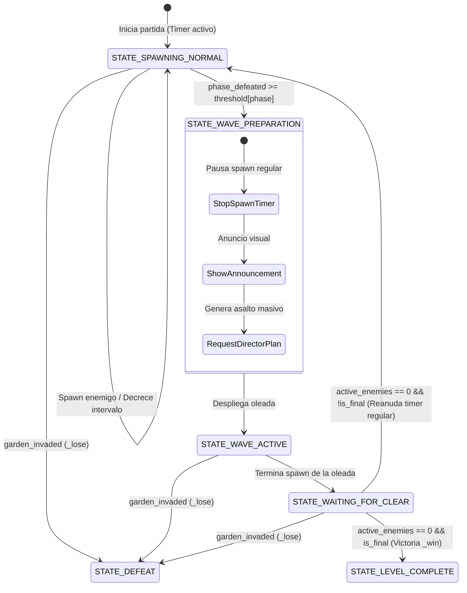

# Data Model: Sistema Híbrido de Oleadas por Bajas y Medidor Visual de Progreso

## Entidades y Estructuras de Datos

### 1. `WaveProgressionState` (Modelo de Estado de Progresión)
Gestionado dentro de `level.gd` para la orquestación del flujo de la partida.

| Campo | Tipo | Valor Inicial | Descripción |
| :--- | :--- | :--- | :--- |
| `wave_kill_thresholds` | `Array[int]` | Configurado por nivel | Lista de bajas necesarias para cada fase (ej. `[15, 20]` para Nivel 1). |
| `current_phase_index` | `int` | `0` | Índice de la fase actual (0 a N-1). |
| `phase_defeated_enemies` | `int` | `0` | Contador de bajas de la fase activa. Se resetea a 0 al alcanzar el umbral. |
| `total_defeated_enemies` | `int` | `0` | Contador total acumulado de bajas en el nivel. Alimenta el medidor visual. |
| `total_level_kills` | `int` | Suma de umbrales | Total requerido para llenar el 100% del medidor (`max_value`). |
| `current_spawn_interval` | `float` | `_enemy_spawn_interval` | Cadencia actual de spawn regular. Disminuye con el tiempo en background. |

#### Reglas de Validación
- `wave_kill_thresholds` no debe estar vacío en ningún nivel activo.
- `phase_defeated_enemies` nunca puede ser negativo. Al llegar a `wave_kill_thresholds[current_phase_index]`, se reinicia inmediatamente a `0` y se incrementa `current_phase_index`.
- `total_defeated_enemies` solo se incrementa cuando un enemigo muere válidamente en combate (`health <= 0`), jamás por invasión del jardín (`garden_invaded`) ni descarte.
- `total_defeated_enemies` tiene un tope lógico visual en `total_level_kills` para evitar desbordes en la interfaz durante la oleada final.

#### Máquina de Estados de Oleadas

---

### 2. `WaveProgressBar` (Componente de Interfaz HUD)
Escena autónoma `wave_progress_bar.tscn` con script `wave_progress_bar.gd`.

| Propiedad / Nodo | Tipo | Descripción |
| :--- | :--- | :--- |
| `texture_progress_bar` | `TextureProgressBar` | Nodo principal que renderiza el cristal y el líquido rojo. |
| `fill_mode` | `int` (`3`) | `TextureProgressBar.FILL_BOTTOM_TO_TOP` (de abajo hacia arriba). |
| `texture_over` | `Texture2D` | Marco de cristal del reloj (`wave_meter_2_waves.png` o `wave_meter_3_waves.png`). |
| `texture_progress` | `Texture2D` | Textura de líquido rojo recortada al ancho interno del tubo (`wave_meter_red_progress.png`). |
| `max_value` | `float` | Total de bajas del nivel (`total_level_kills`). |
| `value` | `float` | Bajas acumuladas actuales (`total_defeated_enemies`). |

#### Métodos de la Interfaz
- `setup(max_kills: int, meter_texture: Texture2D) -> void`: Configura el rango máximo y el marco gráfico de 2 o 3 oleadas.
- `update_progress(current_kills: int) -> void`: Actualiza el valor visual del medidor de forma inmediata o interpolada.
