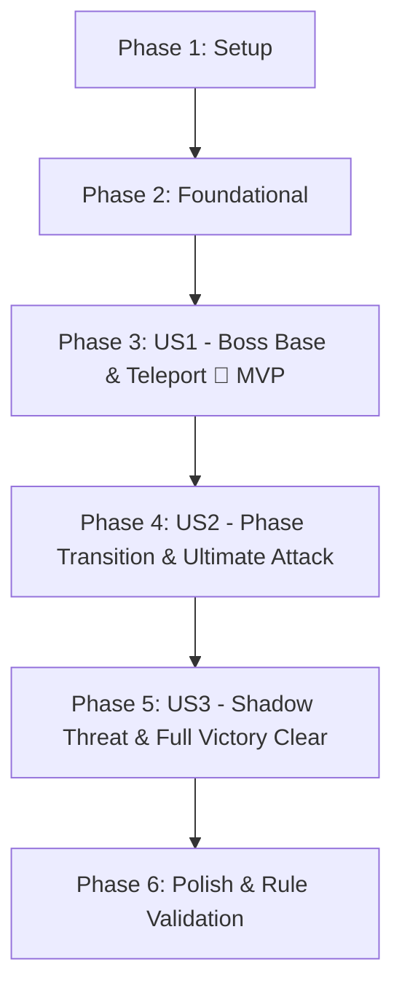

# Tasks: Nivel 10 - Batalla contra Jefe Final (Quirrell / Voldemort)

**Branch**: `014-nivel-10-quirrell-boss` | **Date**: 2026-10-12 | **Spec**: [spec.md](spec.md) | **Plan**: [plan.md](plan.md)

## Phase 1: Setup (Shared Infrastructure)

**Purpose**: Verificar recursos visuales compartidos y constantes base del escenario final.

- [X] T001 Verificar disponibilidad y dimensiones de recursos gráficos en `Images/final_background.png`, `Images/quirrell.png`, `Images/quirrell_turban.png` y `Images/character_shadow.png`
- [X] T002 Definir constantes de posicionamiento del jefe en columna 8 (`GRID_COL_8_X = 1280.0`) y filas activas 2 a 6 en `level.gd`

---

## Phase 2: Foundational (Blocking Prerequisites)

**Purpose**: Componentes base de interfaz, entidad esbirro e infraestructura en `level.gd` requeridos por todas las historias de usuario.

**⚠️ CRITICAL**: Ninguna historia de usuario puede completarse sin estos componentes base.

- [X] T003 [P] Implementar escena y script de la barra de vida del jefe en `boss_health_bar.tscn` y `boss_health_bar.gd` (`min_value: float = 0.0`, `max_value: float = 36000.0`, `set_health(current: float)`)
- [X] T004 [P] Implementar escena y script del esbirro Sombra en `shadow_enemy.tscn` y `shadow_enemy.gd` (`extends Enemy`, `speed: float = 48.0`, `health: float = 200.0`, `damage_per_second: float = 30.0`, grupo `enemies`)
- [X] T005 Incorporar soporte para modo jefe en `level.gd` (`@export var is_boss_level: bool = false`, ocultamiento del medidor de oleadas y reserva de celda ocupada por el jefe)

**Checkpoint**: Infraestructura base lista - la implementación de las historias de usuario puede comenzar.

---

## Phase 3: User Story 1 - Duelo contra el Jefe Final Estacionario y Teletransportación (Priority: P1) 🎯 MVP

**Goal**: Disponer en la arena final al Profesor Quirrell como jefe estacionario en columna 8 con 36.000 HP, barra de vida en HUD, teletransporte cada 20s con aplastamiento de aliados y condición de victoria al derrotarlo.

**Independent Test**: Ejecutar `level_10.tscn`, verificar que Quirrell aparezca en columna 8, no avance hacia el jardín, la barra superior refleje su vida al recibir daño de proyectiles/explosiones, se teletransporte cada 20s entre filas activas aplastando aliados en su celda de destino y su derrota active el fin del nivel.

### Implementation for User Story 1

- [X] T006 [P] [US1] Crear escena de Quirrell en `quirrell.tscn` con nodo raíz `Area2D`, colisión `CollisionShape2D`, sprite base `quirrell.png`, turbante `quirrell_turban.png`, sombra de pies `character_shadow.png` y temporizadores
- [X] T007 [US1] Implementar atributos base, grupo `enemies` y recepción de daño en `quirrell.gd` (`max_health: float = 36000.0`, `health: float = 36000.0`, `take_damage(amount: float) -> void`, señales `health_changed` y `defeated`)
- [X] T008 [US1] Implementar temporizador e intervalo de teletransporte cada 20.0s en `quirrell.gd` con selección aleatoria entre las 4 filas activas restantes y emisión de señal `teleported(from_cell: Vector2i, to_cell: Vector2i)`
- [X] T009 [US1] Construir la escena del escenario final en `level_10.tscn` con fondo `final_background.png`, 5 filas activas (2 a 6), paleta de 9 cartas de aliados, barra de vida `boss_health_bar.tscn` en el HUD y Quirrell instanciado en columna 8
- [X] T010 [US1] Integrar control de celda y aplastamiento en `level.gd`: bloquear plantación en celda de Quirrell (`Vector2i(8, row)`), conectar `teleported` para aplastar aliados con daño 9999.0 y conectar `defeated` con la victoria del nivel

**Checkpoint**: User Story 1 funcional y comprobable de forma autónoma como MVP del combate.

---

## Phase 4: User Story 2 - Progresión de Fases del Jefe y Caída del Turbante (Priority: P2)

**Goal**: Escalar la dificultad al reducir la vida de Quirrell al 50% (18.000 HP o menos), ocultando el turbante para mostrar el rostro de Voldemort, acelerando el ciclo de invocación a 8s y añadiendo un 10% de probabilidad de ataque masivo en las 5 líneas.

**Independent Test**: Reducir la vida de Quirrell a 18.000 HP o menos, comprobar que el turbante desaparezca, el intervalo pase de 15s a 8s y evaluar que el 10% de las invocaciones invoque sombras en las 5 líneas y el 90% en la línea actual.

### Implementation for User Story 2

- [X] T011 [US2] Implementar detección y transición a Fase 2 en `quirrell.gd`: ocultar `$TurbanSprite` al llegar `health <= 18000.0`, actualizar `current_phase = 2` y cambiar intervalo a `invocation_time_phase_2 = 8.0`
- [X] T012 [US2] Implementar ciclo de invocación periódica y cálculo de habilidad definitiva (10%) en `quirrell.gd`: en Fase 1 invocar cada 15s (`shadow_spawn_requested`); en Fase 2 cada 8s evaluar `randf() < 0.10` para emitir `mass_shadow_spawn_requested` o `shadow_spawn_requested`
- [X] T013 [US2] Conectar señales de invocación de sombras en `level.gd` instanciando `shadow_enemy.tscn` en la línea de Quirrell o en las 5 líneas activas en caso de ataque definitivo

**Checkpoint**: User Story 2 integrada y funcional; ambas fases operan de forma reactiva y escalada.

---

## Phase 5: User Story 3 - Amenaza Rápida de las Sombras Invocadas y Apoyo de Enemigos (Priority: P3)

**Goal**: Generar enemigos regulares de todos los tipos como apoyo constante durante la batalla y asegurar la aniquilación automática de todas las sombras y enemigos al morir Quirrell.

**Independent Test**: Verificar que Slytherin Student, Draco, Protego Student, Slytherin Prefect y Troll aparezcan periódicamente durante el combate, y que al reducir la vida de Quirrell a 0, todos los enemigos y sombras activos en pantalla sean derrotados inmediatamente.

### Implementation for User Story 3

- [X] T014 [US3] Configurar generadores de oleadas de apoyo regular en `level_10.tscn` con los 5 tipos de enemigos (`SlytherinStudent`, `Draco`, `ProtegoStudent`, `SlytherinPrefect`, `Troll`) en las 5 filas activas
- [X] T015 [US3] Implementar limpieza total de enemigos activos al derrotar al jefe en `level.gd`: iterar sobre el grupo `enemies` eliminando o derrotando cada entidad restante antes de disparar la pantalla de victoria final

**Checkpoint**: Todas las historias de usuario (US1, US2, US3) integradas y funcionando en armonía.

---

## Phase 6: Polish & Cross-Cutting Concerns

**Purpose**: Verificación de estándares de código de la cátedra, cobertura de pruebas rápidas y limpieza final.

- [X] T016 Ejecutar `tools/check_rules.gd` para garantizar cumplimiento estricto de máximo 15 líneas por método, tipado estático completo y ausencia de números mágicos en `quirrell.gd`, `shadow_enemy.gd`, `boss_health_bar.gd` y `level.gd`
- [X] T017 Ejecutar los 6 escenarios de validación detallados en `specs/014-nivel-10-quirrell-boss/quickstart.md` en Godot Engine y capturar evidencias de funcionamiento
- [X] T018 Actualizar bitácora y estado de tareas en `specs/014-nivel-10-quirrell-boss/tasks.md`

---

## Dependencies & Execution Order

### Phase Dependencies

- **Setup (Phase 1)**: Sin dependencias previas; comienza inmediatamente.
- **Foundational (Phase 2)**: Depende de Phase 1. Bloquea el desarrollo de las Historias de Usuario.
- **User Story 1 (Phase 3)**: Depende de Phase 2. Establece el MVP jugable del Nivel 10.
- **User Story 2 (Phase 4)**: Depende de US1 (requiere a Quirrell instanciado y recibiendo daño).
- **User Story 3 (Phase 5)**: Depende de US1 y US2 (requiere el ciclo de invocación y spawner de nivel).
- **Polish (Phase 6)**: Depende de la finalización de US1, US2 y US3.

### User Story Dependencies

---

## Parallel Opportunities

- **Phase 2**:
  - `T003` (`boss_health_bar.gd`) y `T004` (`shadow_enemy.gd`) pueden implementarse en paralelo por tocar archivos completamente independientes.
- **Phase 3**:
  - `T006` (`quirrell.tscn`) puede diseñarse en paralelo con `T009` (`level_10.tscn`).
- **Phase 4 & 5**:
  - `T014` (configuración de spawners en `level_10.tscn`) puede prepararse en paralelo con `T011` y `T012` (`quirrell.gd`).

---

## Implementation Strategy

### MVP First (User Story 1)

1. Completar Setup (Phase 1) y Foundational (Phase 2).
2. Implementar User Story 1 (T006 a T010).
3. **Validar MVP**: Ejecutar `level_10.tscn`, comprobar que Quirrell ocupa la columna 8, recibe daño, se teletransporta cada 20s y se puede ganar el nivel al agotar sus 36.000 HP.

### Entrega Incremental

1. MVP funcional (US1).
2. Agregar transición de fases y ataque definitivo del 10% (US2).
3. Agregar oleadas de apoyo regular y limpieza total al vencer al jefe (US3).
4. Verificación de reglas de la cátedra con `check_rules.gd` y validación de `quickstart.md` (Phase 6).
